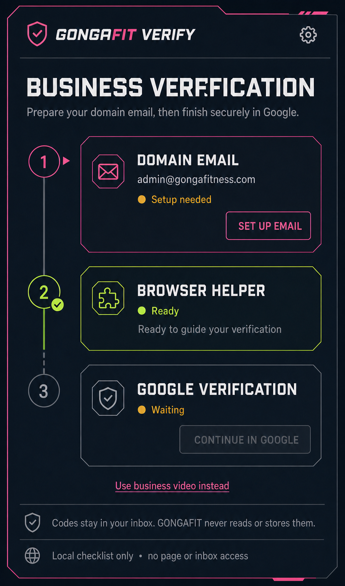

# GONGAFIT Verify — browser extension design

Status: **ImprovMX selected and DNS-active; delivery test pending; extension not implemented**  
Date: **2026-07-19**



## Goal

Build a small Chrome/Edge Manifest V3 companion that helps the owner prepare for and complete the Google Business Profile verification offered for `gongafitness.com`.

The companion is a readiness checklist and launcher. It does not create a mailbox, request or capture verification codes, read an inbox, automate Google, or claim that it can guarantee verification.

## Current state

A follow-up public DNS check on 2026-07-19 found:

- DNS is hosted by Amazon Route 53.
- ImprovMX is active with MX priority `10` at `mx1.improvmx.com` and priority `20` at `mx2.improvmx.com`.
- The apex publishes `v=spf1 include:spf.improvmx.com ~all`.
- The ImprovMX dashboard shows a catch-all (`*`) alias, so unmatched addresses including `admin@gongafitness.com` route to the configured destination inbox.
- No DMARC record is published. DMARC should be added as later hardening but does not block inbound forwarding.
- No DKIM record was found at common provider selectors. Provider-defined selector names mean public DNS cannot prove exhaustive absence.
- `www.gongafitness.com` continues to point at Railway. Mail records can be added without changing that web record or the Route 53 nameservers.

The remaining mail-readiness step is to send a message to `admin@gongafitness.com` from an unrelated account and confirm it reaches the configured destination inbox before asking Google to send a verification code.

## V1 workflow

1. **Test the active ImprovMX forward.** Send to `admin@gongafitness.com` from an unrelated account and confirm delivery at the configured destination inbox.
2. **Open GONGAFIT Verify.** The extension shows three states: Domain email, Browser helper, and Google verification.
3. **Mark the mailbox ready after a successful test.** V1 stores this non-sensitive checklist state locally.
4. **Continue in Google.** The extension opens the official Business Profile flow. The owner requests and enters the code directly in Google.
5. **Use business video when required or preferred.** The extension presents the official filming checklist and hands the owner back to Google's mobile capture flow.

Google chooses which verification methods are available and may require more than one method. The extension must describe the options Google presents; it must not manufacture or substitute a method.

## Mailbox choices

| Choice | Best for | Notes |
|---|---|---|
| Google Workspace | Permanent business mailbox | Recommended long-term option if Gongafit wants a real managed inbox. Verify the domain, add Google's generated MX/TXT/DKIM records, then add SPF and DMARC. |
| **ImprovMX — selected** | Fast receive-only forwarding | The domain and catch-all are active. Confirm delivery to `admin@` from an unrelated sender. This is not a full sending mailbox unless a sending service is also configured. |
| Microsoft 365 | Outlook-based permanent mailbox | Use the Microsoft admin wizard's exact Route 53 records. |

Use one inbound provider and one SPF policy. Do not mix providers' MX sets. Leave the Railway `www` CNAME and Route 53 nameservers unchanged.

## Product surface

Use a browser **side panel**, not a tiny popup, so the checklist can stay visible beside the official verification page.

- Target width: approximately `400px`; usable from `360px` upward.
- Header: `GONGAFIT VERIFY`, shield mark, settings.
- Primary task: `Business verification`.
- Step 1: `Domain email` with `admin@gongafitness.com`, readiness status, and `Set up email`.
- Step 2: `Browser helper` with a local ready state and `Ready to guide your verification`.
- Step 3: `Google verification` with `Continue in Google`, disabled until the mailbox is marked tested.
- Alternate path: `Use business video instead`.
- Persistent security copy: `Codes stay in your inbox. GONGAFIT never reads or stores them.`
- Permission disclosure: `Local checklist only • no page or inbox access`.

The visual direction reuses Gongafit's near-black/navy surfaces, angular geometry, hot-pink brand accent, acid-lime success state, amber pending state, condensed headings, and clean sans-serif controls. It does not imitate Google's visual identity or imply Google endorsement.

## State model

```text
MAILBOX_NOT_CONFIGURED
  -> MAILBOX_CONFIGURING
  -> MAILBOX_TESTED
  -> GOOGLE_FLOW_OPENED
  -> OWNER_MARKED_VERIFIED

Any state -> VIDEO_CHECKLIST
```

Only checklist state, timestamps, and the chosen mail-provider label belong in local storage. Never store a PIN, inbox content, Google cookies, Google tokens, DNS credentials, or registrar credentials.

## Technical architecture

Keep the extension separate from the Next.js application because Manifest V3 uses a different build and service-worker lifecycle.

```text
FitsiteGonga/browser-extension/
  package.json
  wxt.config.ts
  entrypoints/
    background.ts
    sidepanel/
      index.html
      main.tsx
      App.tsx
  src/
    components/
    lib/storage.ts
    lib/verification-state.ts
  tests/
```

- Stack: React, TypeScript, WXT, Manifest V3.
- Output: one Chromium build usable in Chrome and Edge.
- V1 permissions: `storage` and `sidePanel` only.
- V1 has no content scripts, Google host permission, `tabs`, `cookies`, `identity`, inbox access, backend session, or Google Business Profile API integration.
- Buttons use normal external links to the chosen provider and the official Google flow.
- Progress remains in `chrome.storage.local`.

If backend synchronization becomes valuable later, add a dedicated admin route and use one-time pairing plus short-lived, narrowly scoped extension tokens. Do not reuse or persist a full Gongafit admin refresh token. Extension-origin CORS support must compare the exact scheme and extension ID; the existing URL normalizer cannot safely allow `chrome-extension://` origins.

## Business-video fallback

The checklist should adapt to storefront, hybrid, or service-area businesses. Google's current guidance requires a live, unique, continuous, unedited video recorded and uploaded from a mobile device. It should show location context, business identity or equipment, and proof that the recorder manages the business while avoiding private information and other people's faces.

The extension may generate a checklist and link/QR handoff. It must not accept a prerecorded upload or edit the recording.

## Security and policy boundaries

- The owner explicitly starts every verification attempt.
- Never request codes in the background or repeatedly trigger delivery.
- Never read, transmit, log, or autofill a verification PIN.
- Never scrape Google sessions, cookies, or inboxes.
- Never upload or transform a business-verification video.
- Never imply Google endorsement or guarantee an approval result.
- If published, provide an accurate single-purpose description, minimum-permission disclosure, and privacy policy.

## Acceptance criteria for implementation

- Chrome and Edge load the unpacked production build without warnings.
- The side panel matches the approved concept at desktop and narrow widths.
- Checklist state survives browser restarts and contains no sensitive values.
- `Continue in Google` is unavailable until the mailbox is marked successfully tested.
- External links open correctly without broad host permissions.
- No extension code reads page content, inbox content, cookies, or codes.
- Unit tests cover state transitions and storage parsing.
- The package builds independently and is included in root scripts, `knip.json`, `.gitignore`, and the workspace map.

## References

- [Verify your business on Google](https://support.google.com/business/answer/7107242)
- [Business video verification](https://support.google.com/business/answer/14271705)
- [Protect your Business Profile](https://support.google.com/business/answer/14509283)
- [Google Business Profile API policies](https://developers.google.com/my-business/content/policies)
- [Chrome Web Store policies](https://developer.chrome.com/docs/webstore/program-policies/policies)
- [Chrome Side Panel API](https://developer.chrome.com/docs/extensions/reference/api/sidePanel)
- [Google Workspace MX setup](https://support.google.com/a/answer/6156494)
- [Route 53 record creation](https://docs.aws.amazon.com/Route53/latest/DeveloperGuide/resource-record-sets-creating.html)
- [ImprovMX wildcard aliases](https://improvmx.com/guides/catchall-wildcard-aliases/)
- [ImprovMX DNS configuration](https://improvmx.com/guides/generic-dns-configuration/)
